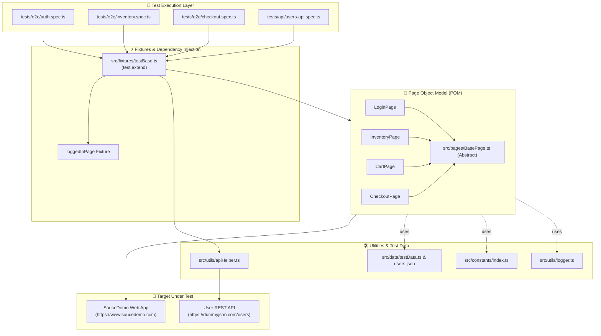

# 🎭 Playwright Enterprise TypeScript Automation Framework

[](https://github.com/matiasoliveraqa/playwright-enterprise-ts/actions/workflows/e2e-tests.yml)
[](https://playwright.dev/)
[](https://www.typescriptlang.org/)
[](https://nodejs.org/)
[](https://opensource.org/licenses/MIT)
[](https://github.com/prettier/prettier)

A production-grade, enterprise-ready end-to-end (E2E) and API test automation framework built with [Playwright](https://playwright.dev/), [TypeScript](https://www.typescriptlang.org/), and modern Page Object Model (POM) architecture. Tested against the real-world e-commerce application [SauceDemo](https://www.saucedemo.com) and microservice REST APIs.

---

## 📑 Table of Contents

- [Key Features](#-key-features)
- [Architecture & Design](#-architecture--design)
- [Repository Structure](#-repository-structure)
- [Prerequisites](#-prerequisites)
- [Quick Start & Installation](#-quick-start--installation)
- [Running Tests](#-running-tests)
- [Reports & Observability](#-reports--observability)
- [Design Patterns & SDET Best Practices](#-design-patterns--sdet-best-practices)
- [CI/CD Automation](#-cicd-automation)
- [Quality Assurance & Code Standards](#-quality-assurance--code-standards)
- [License](#-license)

---

## 🚀 Key Features

- **Strict TypeScript (ES2022 / Modern Bundler)**: 100% type safety with zero implicit `any`, path aliases (`@pages/*`, `@fixtures/*`, `@data/*`), and typechecked contracts.
- **Robust Page Object Model (POM)**: Encapsulated locators and domain actions inheriting from an abstract `BasePage`.
- **Custom Fixture Dependency Injection**: Auto-instantiated page objects and pre-authenticated session contexts via `src/fixtures/testBase.ts`.
- **Full E2E User Journeys**: Comprehensive test coverage across Authentication, Session Management, Inventory Sorting, Cart Manipulation, and Multi-Step Checkout calculations.
- **Microservices API Testing**: High-performance HTTP client utilizing Playwright's native `APIRequestContext` with typed DTO responses, timing benchmarks, and status code assertions.
- **Multi-Browser & Cross-Device Support**: Desktop Chromium, Firefox, WebKit, and mobile viewport emulation (iPhone 12, Pixel 5).
- **Dual Reporting Pipeline**: Integrated Playwright HTML Reporter and enterprise [Allure Report](https://allurereport.org/) with attachments, traces, and step descriptions.
- **Zero-Flake Resilient Selectors**: Configured with `testIdAttribute: 'data-test'` targeting deterministic test IDs over fragile CSS/XPath locators.
- **GitHub Actions CI/CD**: Matrix execution, automated dependency caching, and 30-day artifact retention for test reports and failure traces.

---

## 🏛 Architecture & Design



---

## 📁 Repository Structure

```text
playwright-enterprise-ts/
├── .github/
│   └── workflows/
│       └── e2e-tests.yml        # GitHub Actions CI pipeline
├── .vscode/
│   ├── extensions.json          # Recommended VS Code plugins (Playwright, ESLint)
│   └── settings.json            # Auto-formatting and linting rules
├── src/
│   ├── constants/
│   │   └── index.ts             # Routes, UI error messages, sort enums, timeouts
│   ├── data/
│   │   ├── users.json           # Known user personas (standard, locked, error)
│   │   └── testData.ts          # Typed DTOs, product catalog, customer records
│   ├── fixtures/
│   │   └── testBase.ts          # Extended test runner with auto-injected page objects
│   ├── pages/
│   │   ├── BasePage.ts          # Abstract base page with common navigation & actions
│   │   ├── LoginPage.ts         # Login interactions and error handling
│   │   ├── InventoryPage.ts     # Catalog sorting, cart operations, side menu
│   │   ├── CartPage.ts          # Cart verification and item removals
│   │   └── CheckoutPage.ts      # Multi-step checkout (Info, Overview, Complete)
│   └── utils/
│       ├── apiHelper.ts         # Typed API client wrapper around APIRequestContext
│       └── logger.ts            # Structured contextual logging utility
├── tests/
│   ├── api/
│   │   └── users-api.spec.ts    # REST API CRUD, pagination, and status validations
│   └── e2e/
│       ├── auth.spec.ts         # Login credentials, lockout, logout, security
│       ├── inventory.spec.ts    # Product catalog, sorting, and state management
│       └── checkout.spec.ts     # Complete purchase journey and pricing math
├── .env.example                 # Environment variable templates
├── .gitignore                   # Ignored artifacts, reports, and node_modules
├── .prettierrc                  # Code formatting standard configuration
├── package.json                 # Project dependencies and script definitions
├── playwright.config.ts         # Multi-browser, reporting, and trace policy config
├── tsconfig.json                # TypeScript strict configuration and paths
└── README.md                    # Project documentation
```

---

## ⚙️ Prerequisites

- **Node.js**: `v20.x`, `v22.x`, or `v24.x`
- **npm**: `v10.x` or higher
- **Git**: `v2.x`

---

## 📦 Quick Start & Installation

1. **Clone the repository**:
   ```bash
   git clone https://github.com/matiasoliveraqa/playwright-enterprise-ts.git
   cd playwright-enterprise-ts
   ```

2. **Install project dependencies**:
   ```bash
   npm install
   ```

3. **Install Playwright browser binaries**:
   ```bash
   npx playwright install chromium firefox webkit
   ```
   *(On Linux CI environments, append `--with-deps` to install missing OS libraries)*.

4. **Initialize Environment Configuration**:
   ```bash
   cp .env.example .env
   ```

5. **Verify Setup**:
   ```bash
   npm run typecheck
   npx playwright test --list
   ```

---

## 🧪 Running Tests

The test suite provides granular npm scripts designed for developer efficiency and CI pipelines:

### Run All Tests Across Browsers
```bash
npm test
```

### Browser-Specific Runs
```bash
# Run tests exclusively on Chromium
npm run test:chromium

# Run tests on Firefox
npm run test:firefox

# Run tests on WebKit (Safari)
npm run test:webkit

# Run mobile viewport emulation (iPhone 12 & Pixel 5)
npm run test:mobile
```

### Target-Specific Suites
```bash
# Run all E2E browser tests
npm run test:e2e

# Run all REST API contract tests
npm run test:api
```

### Interactive Debugging & Development
```bash
# Run tests with visible browser window
npm run test:headed

# Open the Playwright interactive UI runner
npm run test:ui

# Step-through execution with the Playwright Debugger
npm run test:debug
```

### Filter by Test Title or File
```bash
# Execute a specific test file
npx playwright test tests/e2e/checkout.spec.ts

# Execute tests matching a regex pattern
npx playwright test -g "mathematical total verification"
```

---

## 📊 Reports & Observability

### 1. Playwright HTML Report
Contains full step execution trees, timings, screenshots on failure, and DOM snapshots:
```bash
npm run report
```

### 2. Allure Report
Generate and serve interactive enterprise Allure reports:
```bash
# Generate report from allure-results
npm run allure:generate

# Open the interactive web dashboard
npm run allure:open
```

### 3. Trace Viewer
Every test failure automatically captures a complete timeline trace including network requests, console logs, and action filmstrips:
```bash
npx playwright show-trace test-results/<test-run-folder>/trace.zip
```

---

## 💡 Design Patterns & SDET Best Practices

### 1. Clean Page Object Model (POM)
Each webpage is represented as a distinct TypeScript class extending [`BasePage`](file:///home/kraper/Projects/playwright-enterprise-ts/src/pages/BasePage.ts). Locators and actions are strictly encapsulated:
```typescript
// Test code reads like a user story, not raw DOM queries
await inventoryPage.addItemToCart('Sauce Labs Backpack');
await inventoryPage.openCart();
await cartPage.proceedToCheckout();
await checkoutPage.fillInformation(customer);
await checkoutPage.finishCheckout();
```

### 2. Custom Fixtures & Dependency Injection
Page objects are automatically created and provided through Playwright's fixture system via [`src/fixtures/testBase.ts`](file:///home/kraper/Projects/playwright-enterprise-ts/src/fixtures/testBase.ts).
- No manual `new LoginPage(page)` instantiations in test files.
- Reusable `loggedInPage` fixture auto-authenticates before test steps and tears down cleanly.

### 3. Deterministic Locators with `data-test`
By setting `testIdAttribute: 'data-test'` in `playwright.config.ts`, test selectors bind directly to resilient data attributes:
```typescript
this.usernameInput = page.locator('[data-test="username"]');
this.checkoutButton = page.locator('[data-test="checkout"]');
```

### 4. Independent, Atomic Tests
Each test case runs in its own isolated browser context with separate cookies, local storage, and cache. Tests can run in parallel without ordering dependencies or side effects.

### 5. Mathematical & Business Logic Verification
Tests validate actual business rules—such as verifying that checkout subtotal, dynamic sales tax, and final order totals compute accurately:
```typescript
const actualSubtotal = await checkoutPage.getSubtotal();
const actualTax = await checkoutPage.getTax();
const actualTotal = await checkoutPage.getTotal();

expect(actualSubtotal).toBe(expectedSubtotal);
expect(actualTotal).toBe(parseFloat((actualSubtotal + actualTax).toFixed(2)));
```

---

## 🔄 CI/CD Automation

This repository includes a production-ready GitHub Actions workflow in [`.github/workflows/e2e-tests.yml`](file:///home/kraper/Projects/playwright-enterprise-ts/.github/workflows/e2e-tests.yml):

- **Triggers**: On every `push` and `pull_request` against `main` or `master`, as well as on-demand via `workflow_dispatch`.
- **Parallel Execution**: Automatic parallel worker allocation for optimal build times.
- **Artifact Publishing**:
  - `playwright-html-report`: Saved on every run with 30-day retention.
  - `allure-results`: Archived for integration with Allure dashboards.
  - `test-failure-artifacts`: Failure screenshots, execution videos, and full trace archives.

---

## 🧹 Quality Assurance & Code Standards

Format code according to Prettier standards:
```bash
npm run format
```

Verify formatting compliance:
```bash
npm run format:check
```

Validate strict TypeScript typing:
```bash
npm run typecheck
```

---

## 👤 Author
**Matías Olivera** — *Senior QA Engineer & SDET*  
- **GitHub**: [@matiasoliveraqa](https://github.com/matiasoliveraqa)  
- **LinkedIn**: [linkedin.com/in/matiolivera](https://www.linkedin.com/in/matiolivera/)  
- **Email**: [matiluzardo3@gmail.com](mailto:matiluzardo3@gmail.com)

---

## 📄 License

This project is licensed under the [MIT License](LICENSE).
